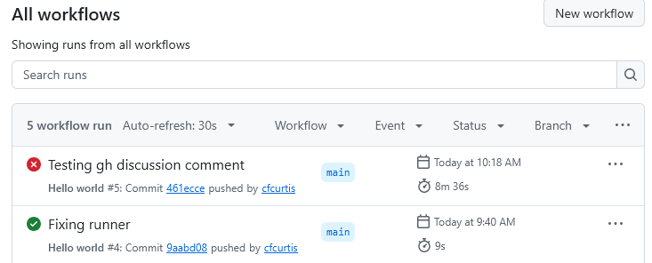
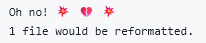

# Lab 7: Continuous Integration Pipelines
*November 4, 2026*

As a FOSS contributor, you probably won't be writing CI workflows from scratch, or at least not very often. However, it's useful to understand how they're defined and what is happening.

## Activity Description
As usual, we'll be relying on GitHub's implementation of this concept to:
- Write a basic workflow
- Understand how to read the results
- Use third-party actions

## Part 1: Hello, world
Once more, you will be working in your fork of the now-thoroughly-abused [git-practice](https://github.com/mru-open-source/git-practice) repo. I closed last week's PRs after checking for completion, but please let me know if I've missed giving you the credit for it.

> [!IMPORTANT]
> Please update your fork before beginning this lab so we're all working from the same place.

Working on your local system, create the subdirectories and file exactly as shown:
```
<your-repo-clone>/.github/workflows/hello.yml
```
where `<your-repo-clone>` is the clone of your fork. You could also use the GitHub action interface to create this, but doing it manually is good for exposing the magic.

Open `hello.yml` in your favourite text editor and enter the following minimal workflow:

```yaml
name: Hello world # you can rename this anything you want
on: push # or try workflow_dispatch to be able to run manually

jobs: # required keyword
  say_hello: # you can rename this as well
    runs-on: ubuntu-latest # defines the system running the job
    steps: # required keyword
      - name: Say hello # Also a name that you invent
        run: echo "Hello, world!" # The actual command that runs
```

All of this is required just to write out Hello world!

Add the file, commit, and push. Then, visit your fork on the GitHub website and click on the "Actions" tab. You should see either a red :x: or a green :checkmark: next to your commit message, as in the example below:



### If you have a green checkmark
It ran successfully! Click on the commit message ("Fixing runner", in this example), then keep clicking though your "say hello" steps until you can actually see the output of `Hello, world!`. It's not a very intuitive system, as it's designed for automation rather than human feedback.


### If you have a red X
Something went wrong. Again, click on the commit message ("Testing gh discussion comment" in this example) and keep clicking on red Xs until you find the failure message. Fix your workflow and try again.

## Part 2: Using third-party actions
Many CI pipelines do similar things, so people publish various "Actions" to avoid reinventing the wheel each time. For example, it is very common to do things like:
- Check out the code in your repo
- Perform linting (code quality and style checks)
- Compile the code
- Run tests
- Build various release versions

> [!TIP]
> Checking out your code is necessary because the action is not running "inside" your repository, it's running on a separate virtual machine.

1. Adding on to your `hello` workflow, create a new "job" named `run_tests`
2. Add the "checkout" step:
  ```yaml
  - name: Checkout code
    uses: actions/checkout@v7 # runs the action from https://github.com/actions/checkout
  ```
  By default, this will only checkout the latest commit instead of the entire repository, so it's pretty fast.

3. Add a code style check for the Python code in `silly_example`:
  ```yaml
  - name: Style check # or whatever you want
    uses: jpetrucciani/black-check@26.10.1 # this is a random action by a random user
    with:
      path: "silly_example" # tell the black check command where the Python code is
  ```

You should have two jobs defined in your workflow now. Once more, commit and push changes, then check for errors in your action. This time, a red X is actually expected, as my Python code fails the [black](https://black.readthedocs.io/) formatting check. However, it shouldn't fail for other reasons — it should show (after clicking through the failing pipeline) something like the following:



To get the checkmark for this lab, open a PR in [git-practice](https://github.com/mru-open-source/git-practice) to contribute your workflow file. Don't actually merge it in.

### A Docker detour
> [!NOTE]
> This section is just for interest, it's not necessary to get credit for the lab.

We could have written the `black` style check manually by installing Python and running the command, e.g.:

```yaml
- name: Setup Python
  uses: actions/setup-python@v7
- name: Check style
  run: |
    pip3 install black
    black --check silly_example
```

Instead, we used someone's [pre-made action](https://github.com/jpetrucciani/black-check). Partly this was just an excuse to show how you can run actions, but doing it this way has the advantage of being able to easily lock the version. In the manual version above, what version of Python am I using? What about black?

The action uses a [Dockerfile](https://github.com/jpetrucciani/black-check/blob/master/Dockerfile) with a `requirements.txt` file to ensure a consistent version, and our `@26.10.1` is, in turn, version locking the action.

## Submit
To show me the evidence that you did this lab, open a pull request with your workflow in the `git-practice` repo, but do not merge it in. I'm just abusing the PR system as a way of consolidating your completed work.
