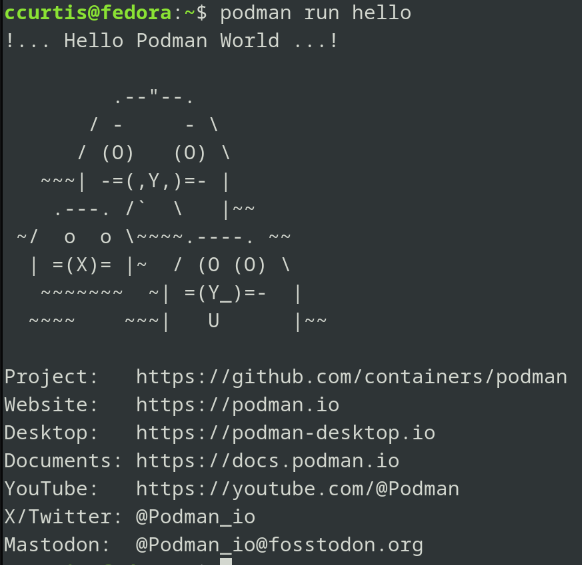

<!--
_class: title_slide
_paginate: skip
-->

# <!--fit-->COMP 3700A: Contributing to Open Source

### <!--fit-->Continuous Integration and Deployment

Charlotte Curtis
November 2, 2026

---

## Topic Overview
- What problem is solved by CI/CD
- What is CI/CD
- Common implementations (YAML)
- CI/CD problems specific to FOSS

Primary reference: [Martin Fowler on CI](https://martinfowler.com/articles/continuousIntegration.html)

---

## The problem

Imagine constructing a building:
- Plumbers, electricians, framers, drywallers, etc
- Things might work in isolation, but bringing them together (**integration**) introduces unexpected problems
- It's easier to integrate small changes than big ones

> Just because everything works on your computer doesn't mean it will everywhere!

---

## Continuous Integration
1. Make changes (feature,  bugfix, etc)
2. Pull upstream changes
3. Resolve conflicts, build locally
4. Push changes
5. Automatic centralized CI service build and testing

> Common constraint: anything merged into main must pass CI tests

---

<!-- _class: discussion_question -->

What kinds of problems might be caught in CI that could be missed locally?

---

## CI services
- [GitHub/GitLab Actions](https://github.com/features/actions)
- [CircleCI](https://circleci.com/)
- [Jenkins](https://www.jenkins.io/)
- Probably others

> Most use YAML files to configure 

---

<!-- _class: discussion_question -->

How does CI/CD in FOSS differ from commercial software dev?

---

## YAML Ain't Markup Language
- YAML is a file format to hold structured data
- Similar to JSON, but designed for [human-readability](https://www.bairesdev.com/tools/json2yaml/)

```yaml
key: value # a comment
another-key:
  - a
  - list
  - ""of values # quotes not necessary but allowed
  nested-key: 0 # simple data types recognized
command: |
  multiline strings can be
  very useful
```

---

## GitHub actions example

```yaml
name: learn-github-actions
run-name: ${{ github.actor }} is learning GitHub Actions
on: [push]
jobs:
  check-bats-version:
    runs-on: ubuntu-latest
    steps:
      - uses: actions/checkout@v6
      - uses: actions/setup-node@v7
        with:
          node-version: '24'
      - run: npm install -g bats
      - run: bats -v
```

<footer>from <a href="https://docs.github.com/en/actions/tutorials/create-an-example-workflow">https://docs.github.com/en/actions/tutorials/create-an-example-workflow</a></footer>

---

## Continuous Delivery/Deployment
- The "D" in CI/CD can stand for **Delivery** or **Deployment**
- In order of increasing automation:
  - Integration: Builds and runs tests
  - Delivery: Prepares builds for release
  - Deployment: Releases to customers

> What are some pros and cons of continuous deployment?

<footer>Time for release cycles notetaker</footer>

---

## Release cycles and conventions
- CD build artifacts are often called **nightly builds**
- Common terms:
  - Alpha: Released for testing but may have serious bugs
	- (Feature freeze)
  - Beta: Addresses bugs found in Alpha, but still not stable
	- (String freeze)
  - Release Candidate (RC): should be basically ready
  - Final Release
- Various conventions for numbering or naming releases

---

## Semantic versioning
Specification described in https://semver.org

Given a version number `MAJOR.MINOR.PATCH`, increment the:
 - `MAJOR` version when you make incompatible API changes
 - `MINOR` version when you add functionality in a backward compatible manner
 - `PATCH` version when you make backward compatible bug fixes

> Example: [Pandas](https://pandas.pydata.org/docs/whatsnew/v3.0.0.html)

---

## Calendar versioning
Less formally specified, but summarized at https://calver.org

- Still typically uses `MAJOR.MINOR`, but one or both components are based on the date (e.g. `YYYY.MM`)
- Only captures time between releases
- Best for fixed release cycles

> Example: [Ubuntu](https://en.wikipedia.org/wiki/Ubuntu_version_history)


---

<!-- _class: discussion_question -->

What convention does your project use? Anything other than these two?

---

## Containerization

> A container is a standard unit of software that packages up code and all its dependencies so the application runs quickly and reliably from one computing environment to another. — [Docker website](https://www.docker.com/resources/what-container/)

- A solution to the problem of "but it works on my machine"
- **Not** the same thing as a virtual machine
- Commonly used for CI pipelines, development, deployed for web services

I'm going to rely on someone else' [video overview](https://www.youtube.com/watch?v=EUrFVnCnxLE)

<footer>Originally scheduled as a separate lecture, but I think it fits here</footer>

---

## Implementations
- [chroot](https://en.wikipedia.org/wiki/Chroot) is arguably the first "container" or "sandbox"
- Various other systems over the years
- [Docker](https://www.docker.com) in 2013 has become a defacto standard
- [Kubernetes](https://kubernetes.io/) (or K8s) was launched in 2014 to "orchestrate" Docker containers
- [Podman](https://podman.io/) was created in 2018 to be highly compatible with Docker, but daemonless, without root access by default

---

## Hello world
- The [Hello world](https://hub.docker.com/_/hello-world) Docker image is as simple as it gets
- The [source code](https://github.com/docker-library/hello-world) looks kind of complicated though
- [Podman](https://github.com/containers/PodmanHello) is similar



---

## Additional reading
Here are some additional references that I used:
- [Docker vs Podman YouTube short](https://www.youtube.com/shorts/OM3LfuQRL3s)
- [A Decade of Docker Containers](https://cacm.acm.org/research/a-decade-of-docker-containers/) for a more technical overview

---

## Coming up next
- Performing code reviews
- Unit testing
- Project part 2 presentations
- Lab: workflow exercise
